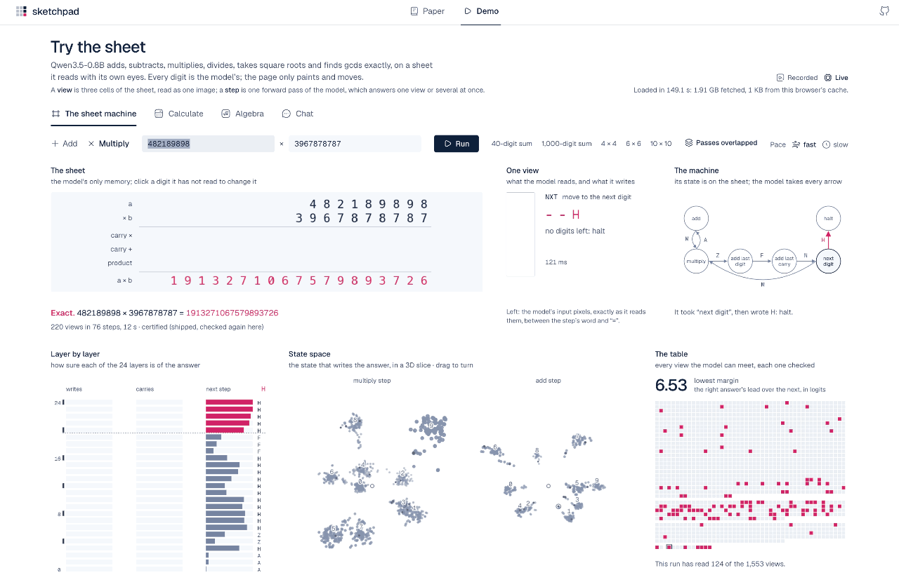

<h1 align="center">Sketchpad</h1>

<p align="center"><b>Certified exact arithmetic with a small vision-language model</b></p>

<p align="center">
  <a href="https://neovand.github.io/sketchpad/">Project page</a> ·
  <a href="https://youtu.be/RTVMdf301sg">Film</a> ·
  <a href="https://neovand.github.io/sketchpad/paper">Paper</a> ·
  <a href="https://neovand.github.io/sketchpad/sketchpad.pdf">PDF</a> ·
  <a href="https://neovand.github.io/sketchpad/demo">Demo</a> ·
  <a href="https://huggingface.co/mohsenvand/sketchpad-0.8b-preview">Model</a>
</p>

<p align="center">
  <a href="https://neovand.github.io/sketchpad/demo"></a>
</p>

Sketchpad gives Qwen3.5-0.8B a sheet to compute on, the way a person does long arithmetic on paper. A low-rank adapter
(10.2 M parameters, 1.2% of the model) teaches it to read three cells of the sheet as a small image and to answer with
a digit, a carry and the next step. Ordinary code writes the answer onto the sheet and moves the view. Every digit is
computed by the model itself: there is no calculator and no tool call.

Because each step sees only those three cells, every situation the model can ever meet fits in a finite list of
**2,446 views**. Checking all of them on the device that runs the model certifies its arithmetic on inputs of every
length, and the proofs of that claim are checked in Lean. The demo checks the weakest views again on your own GPU
before it starts.

## Results

- **Certified on the device.** All 2,446 views pass on an Apple M4 (WebGPU, 16-bit, in the browser). For the
  arithmetic adapter the smallest margin is 3.02 logits, and batching moved any logit by at most 1.09, under the 1.51
  that could flip an answer.
- **Proved in Lean.**
  - Exactness on the views is equivalent to exactness at every length (Theorem 1).
  - When a step reads earlier steps, as in chain of thought, no finite test suffices (Theorem 2).
  - Certificates survive small numerical perturbations (Theorem 3), and certified procedures compose (Theorem 4).
- **220 of 220** pre-registered problems: sums of 10 to 1,000 digits and products of 2- to 20-digit numbers. The
  strongest of ten other models (GPT-6.1 Sol) answered 217. The same base model without its sheet answered 23.
- **One model, many procedures.**
  - Signed addition and subtraction, long multiplication and division, square roots and greatest common divisors,
    all at any length.
  - A symbolic runtime built on these procedures solves, expands and factors polynomials, with every number computed
    by the model.
- **Chat with a gate.** A dialogue adapter opens the sheet when a question needs exact arithmetic. A multiplicative
  gate on the adapter returns the base model bit for bit at zero.
  - Limitation: on fresh grade-school word problems the dialogue adapter scores 5.8 points below the base model (see
    the paper).

## Links

|                                       |                                                                                               |
| ------------------------------------- | --------------------------------------------------------------------------------------------- |
| Project page                          | <https://neovand.github.io/sketchpad/>                                                        |
| The film (4:49)                       | <https://youtu.be/RTVMdf301sg>                                                                |
| Paper (web)                           | <https://neovand.github.io/sketchpad/paper>                                                   |
| Paper (PDF)                           | <https://neovand.github.io/sketchpad/sketchpad.pdf>                                           |
| arXiv                                 | forthcoming                                                                                   |
| Demo (runs in the browser, WebGPU)    | <https://neovand.github.io/sketchpad/demo>                                                    |
| Model, adapter and device certificate | [mohsenvand/sketchpad-0.8b-preview](https://huggingface.co/mohsenvand/sketchpad-0.8b-preview) |
| Training runs and their evaluations   | [mohsenvand/sketchpad-0.8b-runs](https://huggingface.co/mohsenvand/sketchpad-0.8b-runs)       |

## Run it locally

```bash
pnpm install
pnpm dev
```

Then open <http://localhost:5173/>.

- The demo plays recorded runs until you press **Load the model**.
- Loading fetches the published model from Hugging Face (about 1.9 GB, cached by the browser after the first time).
- Running it needs a browser with WebGPU, such as a recent Chrome or Edge.

Checks:

```bash
pnpm check
pnpm lint
pnpm test
```

The Lean proofs need [elan](https://github.com/leanprover/elan). The toolchain (Lean 4.35) is pinned in
`paper/lean/lean-toolchain`.

```bash
cd paper/lean
lake build
lake env lean Paper.lean
```

`lake build` checks every proof. `lake env lean Paper.lean` prints the axioms each of the paper's statements uses.

The paper's LaTeX and the arXiv package are built from the same source as the web page:

```bash
node paper/build-tex.ts --pdf
node paper/build-tex.ts --arxiv
```

`--pdf` writes `paper/tex/main.pdf` (it needs tectonic). `--arxiv` writes `paper/arxiv/`, the arXiv package.

## Repository

| Path                 | What it holds                                                                                                                                          |
| -------------------- | ------------------------------------------------------------------------------------------------------------------------------------------------------ |
| `src/routes/`        | the site: the project page (`+page.svelte`), the paper (`paper/`), the demo (`demo/`)                                                                  |
| `src/lib/sketchpad/` | the in-browser runtime: the sheet procedures, the WebGPU worker, the certificate and the panels                                                        |
| `paper/`             | the paper's source (`paper.md`, `refs.bib`), figures, every number's source (`numbers.md`), the Lean proofs (`lean/`), baselines and the arXiv package |
| `research/`          | the scripts that reproduce the paper's numbers                                                                                                         |
| `video/`             | the film's sources: script, scenes, narration and score                                                                                                |
| `static/`            | the site's static files, including the recorded runs and the paper's PDF                                                                               |

## Citation

The arXiv identifier will be added once the paper is posted.

```bibtex
@misc{mohsenvand2026sketchpad,
  title  = {Sketchpad: certified exact arithmetic with a small vision-language model},
  author = {Mohsenvand, Mostafa},
  year   = {2026},
  url    = {https://neovand.github.io/sketchpad/}
}
```

## License

Code and text are licensed under the Apache License 2.0 ([`LICENSE`](LICENSE)). The weights on Hugging Face carry
their own license.
